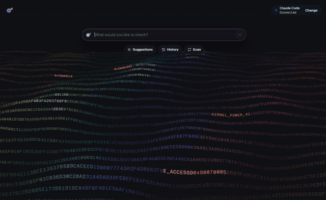
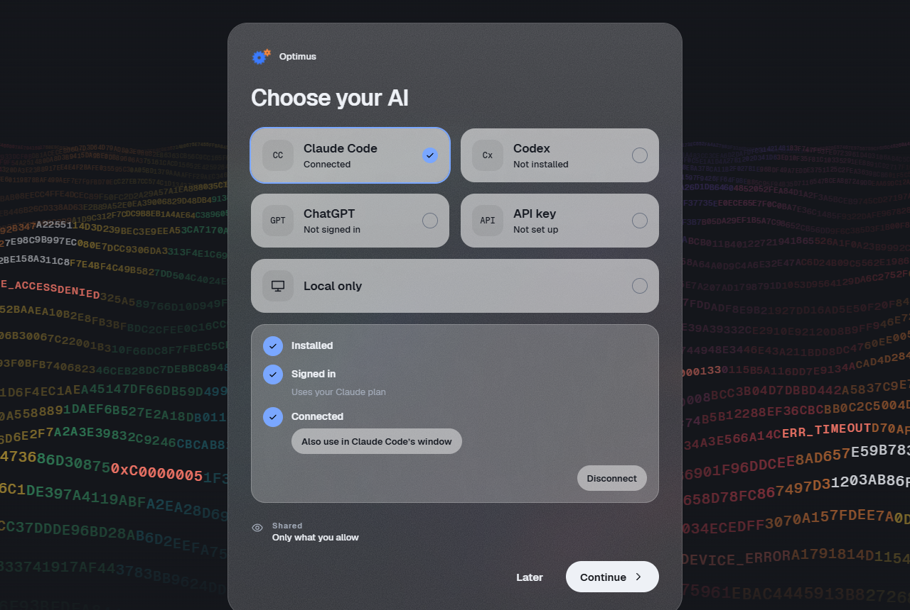
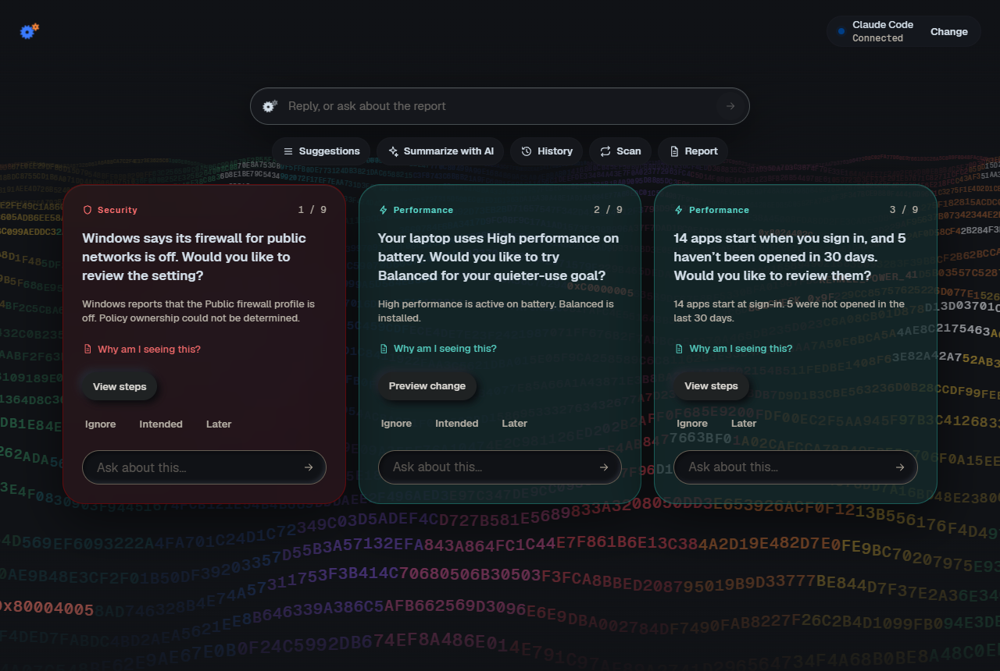
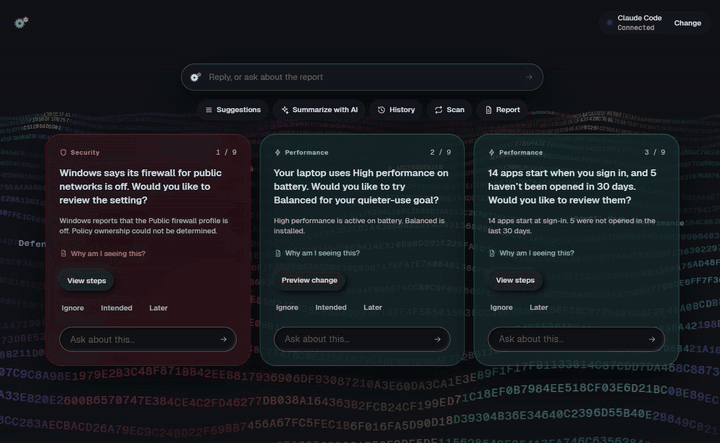
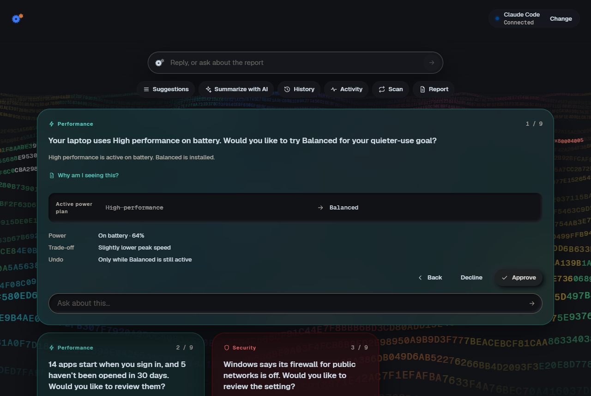
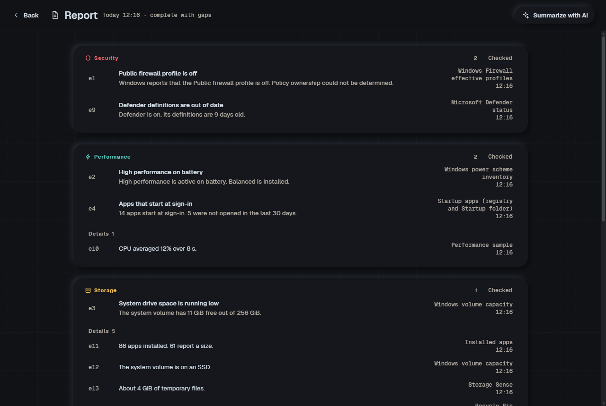

# Optimus

A Windows PC audit and optimization app. It checks security, performance, storage, privacy and startup on your PC, explains what it finds in plain words, and can make approved, reversible changes. Connect an AI (Claude Code, Codex, ChatGPT or an API key) to ask questions about your PC right inside the app, or use it without one.



## Install

Download the `.msi` from [Releases](../../releases/latest) and open it. Windows 10 or 11, 64-bit.

- **Nothing else to install.** The app includes its own .NET runtime, and its screens use Microsoft Edge WebView2, which Windows already has. If it's missing, the installer links to it.
- **"Windows protected your PC"?** The installer isn't signed yet: choose **More info → Run anyway**.
- **Setup:** follow the setup screens and approve the one administrator prompt. Leave **Launch Optimus** ticked on the last screen. Optimus is also in the Start menu and on the desktop.

## How it works

**1. Pick your AI, or none.** Optimus finds Claude Code or Codex wherever they're installed and checks you're signed in. It can also sign in to ChatGPT in your browser or use an API key. It uses your existing plan, and "Local only" works fine too.



**2. Scan.** One click checks security, performance, storage, privacy, diagnostics and startup. What it finds becomes a short list of suggestions, ordered by what you use your PC for.



**3. Ask about your PC.** Type a question. The AI runs the read-only checks it needs, answers inside the app with links to the evidence, and suggests follow-up questions.



**4. Approve changes, and undo them.** Nothing changes without you. You see the exact change first. Afterwards Optimus checks it worked, keeps a receipt, and offers Undo where it can.



**5. Read the full report**, with every finding, its evidence and anything that couldn't be checked.



## Why not just ask Claude or ChatGPT to fix my PC?

Claude Code and Codex can already search your PC and change settings if you give them permission. The difference is how they do it.

- **Safe actions, not made-up commands.** In a chat, the AI writes its own commands, and you approve ones you may not fully understand. In Optimus, the AI can only run read-only checks and suggest changes from a fixed list of safe actions.
- **Every change is checked and recorded.** You see exactly what will change before you approve it. Optimus then confirms the change worked and keeps a record, with Undo where Windows allows it.
- **Private details stay on your PC.** The AI sees labels like "App A" instead of app names, and never sees file paths, account names or network addresses.
- **The same full check every time.** A chat only looks where you point it. Optimus runs the same full scan every time and compares it with the last one.

## Build from source

Only needed for developers: the .NET 10 SDK (see `global.json`), and Node.js for the UI tests.

```
dotnet build OptimizationTool.slnx
dotnet test OptimizationTool.slnx --filter "Category!=Live"
node --test ui/tests/
```

- **Installer:** `powershell -ExecutionPolicy Bypass -File packaging\build-installer.ps1`. It uses WiX; accepting WiX's license is up to you.
- **Browser demo:** the UI also runs in a browser with a simulated backend. Run `node ui/tools/serve.mjs` and open the printed address. The screenshots above come from this demo and use made-up data.

## License

MIT. Third-party notices for the bundled React and Geist fonts are in `ui/vendor/`.
